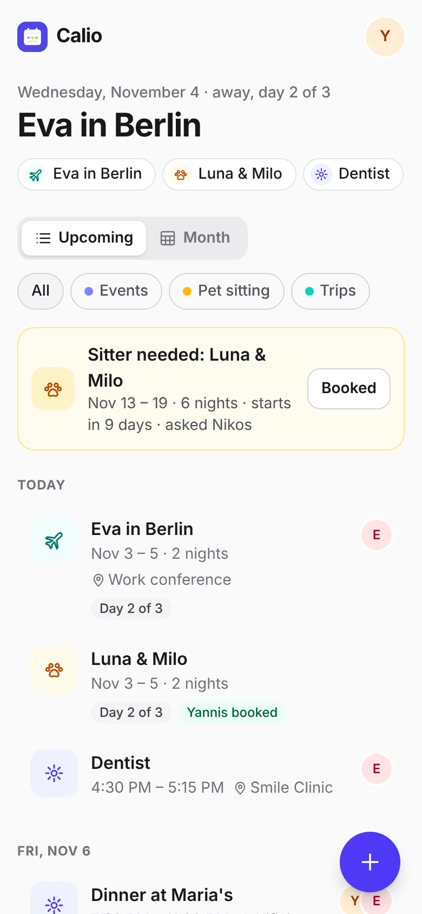
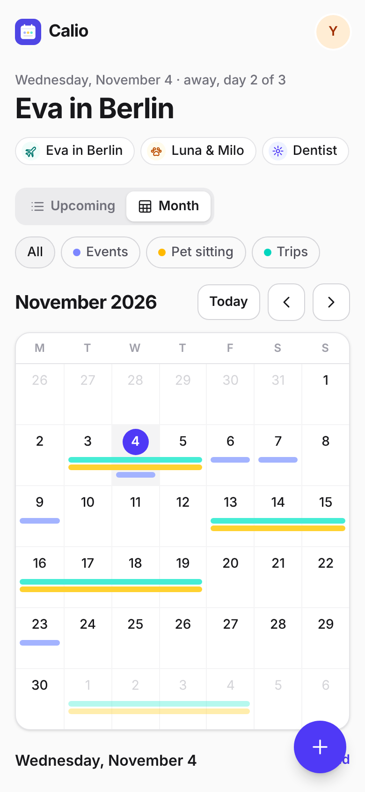
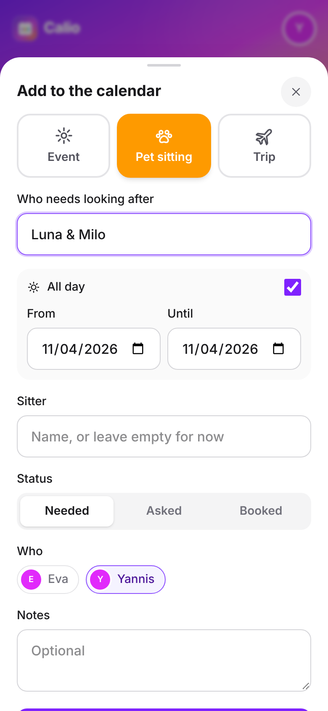
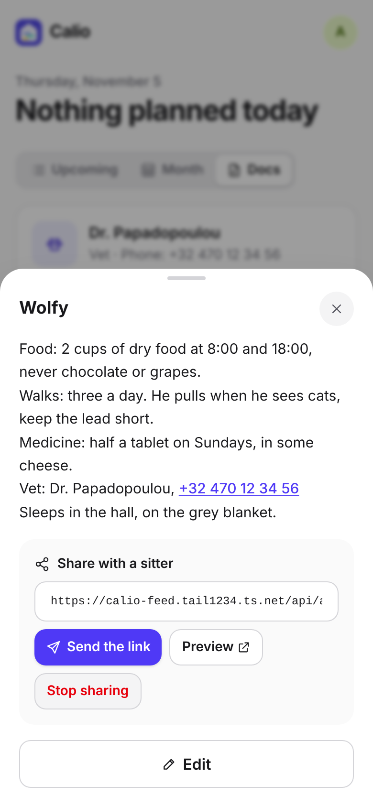
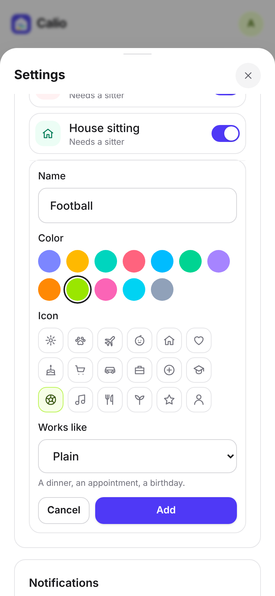
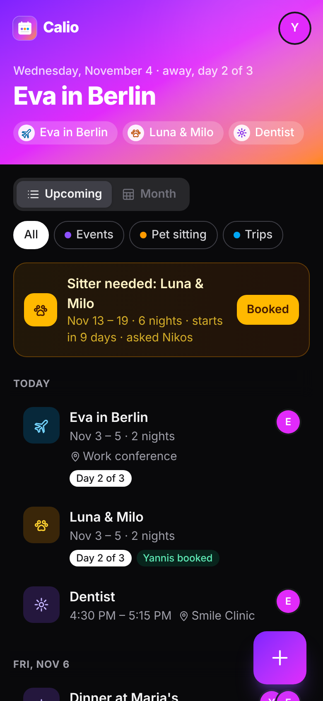
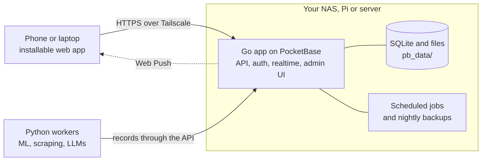

<div align="center">


# Calio

**Your household on one calendar: plans, sitting, trips and the notes a sitter needs,<br>
running on your own hardware.**

&nbsp;
&nbsp;
&nbsp;
&nbsp;
&nbsp;


</div>

Calio is a shared calendar for the people you live with. Everyone signs in on their
own phone and sees the same calendar, live.

- **Your own categories**: Event, Pet sitting and Trip to start, Babysitting to switch
  on, and any you add (House sitting, Football, Grandma's) with a name, a color and an
  icon. Switch off what you don't use in Settings > Categories. A category can work
  like a plain event, like sitting (who's covering it) or like a trip (a packing list).
- **Events** for dinners, appointments and anything else, with a time and a place.
- **Pet sitting**: the days someone needs to look after the pets, who the sitter is, and
  whether they are still needed, asked or booked. Unbooked sitting in the next two weeks
  stays at the top of the app until someone books it.
- **Trips**: where you're going, who's going and where you're staying. Adding a trip can
  add pet sitting for the same dates in one step.
- **Repeating entries**: every day, week, month or year, until a date if you like.
- **Checklists**: a packing list on every trip (start from the last trip's list), and a
  checklist on anything else. Ticking items saves right away, so it works while you pack.
- **Shopping lists** on any entry, for the dinner or the party. With
  [Shoppa](https://github.com/selfhostit/shoppa) set up, one tap sends what's left to
  buy to its list (see [docs/deploy.md](docs/deploy.md#shoppa)).
- **Comments** on entries ("I'll take Luna to the vet first"); everyone else is
  notified.
- **Map links**: a place can be an address, "lat, lon" or a pasted map link, and opens in
  Google Maps.
- **A calendar feed** to subscribe to from Apple Calendar, Outlook or Google Calendar
  (Settings > Calendar feed). Each person's link has its own secret and can be replaced.
  Google Calendar needs the feed reachable from the internet: set `CALIO_FEED_URL` to a
  public address that serves only `/api/app/feed/` and `/api/app/share/` (for example
  through Tailscale Funnel).
- **Documents**: a page about the dog ("Wolfy": food, walks, medicine, the vet's number),
  the house (alarm, plants, bins) or the kids, with photos and files. Share one with a
  sitter through a private link that needs no account, and stop it working when they're
  done. Phone numbers and links in a document are one tap.
- **Upcoming and month views**, filtered by category, in light and dark mode.
- **Notifications**: everyone else hears when something is added, commented on or a sitter
  is booked,
  and at 07:30 a morning summary lists what's on today and sitting that still needs someone.

Calio is built on [plasto](https://github.com/selfhostit/plasto): one small container,
no account anywhere else, and your data stays in `pb_data` on your machine.

## Quick start

You need [Go](https://go.dev/dl/) 1.27+, [Node](https://nodejs.org) 22+ and
[uv](https://docs.astral.sh/uv/) (for the Python workers).

```sh
make setup   # install dependencies
make dev     # backend on :8090, web app with live reload on http://localhost:5173
```

Open the app and create your account with the setup code that `make dev` prints:
you become the **owner** and can also sign in to the admin UI at http://localhost:8090/_/ with the same
email and password. Add more people there, in the `users` collection.

## What you get

- **First-run setup and sign-in.** The first account is made on a setup screen, with a
  one-time code from the installer or the app's log, so nobody else can claim a fresh install.
- **Users and roles.** The owner manages everyone; members can see each other and
  edit themselves. Nobody can sign themselves up.
- **Push notifications** straight from your server, with no account or third-party
  service. Each person turns them on per device; send one from Go with
  `push.ToUser(app, userID, push.Message{Title: "…", URL: "/…"})`. Phones need the
  app on HTTPS.
- **Scheduled jobs that don't get skipped.** `jobs.MustAdd(app, "digest", "0 7 * * *", fn)`
  runs on a cron schedule in your time zone (`TZ`). If the server was off when a job
  was due, it runs once when the server starts again. Every run and its error are
  listed in the admin UI under the `jobs` collection.
- **Nightly backups** of the database and uploads at 03:00, keeping the last 7, in
  `pb_data/backups`. Change the schedule or add S3 storage in the admin UI under
  Settings > Backups.
- **Python workers** for the heavy lifting (ML, scraping, LLMs), on this machine or
  another. They sign in with a worker account and read and write records through
  the API; see [workers/README.md](workers/README.md).
- **An installable app.** It installs to a phone's home screen or a desktop, opens
  offline from its cached shell, and follows the system's light or dark mode.

## How it fits together



Everything a person sees is the web app, served by the Go app. Heavy work runs in
Python workers, here or on another machine, which write records; Go hooks react to
those records and notify people.

## Deploy

On any Linux machine with Docker (a NAS, a Raspberry Pi, a server):

```sh
curl -fsSL https://raw.githubusercontent.com/selfhostit/calio/main/deploy/install.sh | sh
```

It asks for a Tailscale auth key, so your devices reach the app at
`https://calio.<your-tailnet>.ts.net`, and starts it with Docker Compose. See
[docs/deploy.md](docs/deploy.md) for updates, backups, workers, Synology and the Pi.

## Layout

```
backend/            Go app on PocketBase
  main.go           entry point
  app/              routes, hooks and jobs (start here)
  jobs/             scheduled jobs with catch-up
  push/             Web Push: keys, subscriptions, sending
  migrations/       database schema as code
web/                Svelte 5 + Tailwind web app
  src/App.svelte    picks setup, sign-in or the app
  src/components/   screens; Home.svelte is where your app starts
  src/lib/          shared code (API client, session, install) and its tests
  public/           manifest, service worker and icons
workers/            Python worker kit, your workers, their tests and image
deploy/             compose files, Tailscale sidecar, install script, smoke test
docs/               decisions, the deploy guide and the first-feature guide
Dockerfile          the app's multi-arch image
Makefile            run `make` to see every command
```

## Commands

| Command      | What it does                                          |
| ------------ | ----------------------------------------------------- |
| `make dev`   | Run everything with live reload                       |
| `make check` | Format, lint and type-check                           |
| `make test`  | Run the Go, web and worker tests                      |
| `make build` | Build `dist/calio` with the web app next to it       |
| `make run`   | Build the Docker image and run it on :8090            |
| `make smoke` | Deploy both images with Compose and test end to end   |

Pushes to `main` publish `ghcr.io/selfhostit/calio` and
`ghcr.io/selfhostit/calio-worker` for amd64, arm64 and armv7; a `v*` tag
publishes that version.

## Security and maintenance

- **Not on the internet:** the container listens on `127.0.0.1` only; reach it through
  Tailscale or your own reverse proxy with HTTPS (`deploy/docker-compose.yml`). The only
  optional exception is the calendar feed, which Tailscale Funnel can publish on its own
  for Google Calendar (`deploy/docker-compose.funnel.yml`).
- **Locked-down container:** runs as a normal user, drops every Linux capability and
  can't gain new ones; its filesystem is read-only apart from its data.
- **Nobody claims a new install before you:** the first account needs the one-time setup
  code the install prints (`backend/app/setup.go`).
- **Sign-ins are rate limited** (10 a minute, `backend/migrations/*_rate_limits.go`), and the
  web app sends a Content Security Policy (`backend/app/headers.go`).
- **Tested on every change:** Go, web and Python worker tests and an end-to-end run of the published images
  (`make smoke`) in [CI](.github/workflows/ci.yml); Actions are pinned to commit hashes and
  Dependabot keeps Go, npm, Python, Docker and Actions dependencies current.
- **Security scans** on every pull request and every week: CodeQL, govulncheck on the
  Go code, Grype on the other dependencies and the released images, dependency review and
  gitleaks
  ([security.yml](.github/workflows/security.yml)).
- **Versioned releases:** installs update to a release, not to every change on `main`, and
  every image has a signed attestation of the commit and workflow that built it
  ([CHANGELOG.md](CHANGELOG.md), [docs/deploy.md](docs/deploy.md#check-where-an-image-came-from)).
- **No analytics or tracking,** and no account anywhere else: the data stays in `pb_data` on your
  machine, with a nightly backup kept there.

Found a security problem? Please report it privately, not in an issue: see [SECURITY.md](SECURITY.md)
for how, and how quickly it gets fixed. [Security and privacy](https://github.com/selfhostit/docs/blob/main/security.md) covers every selfhostit app:
what protects an install, what you are trusting and what is not done yet.

## Support

If calio saves you time, you can [buy me a coffee](https://buymeacoffee.com/kalfasyan).

## License

MIT
